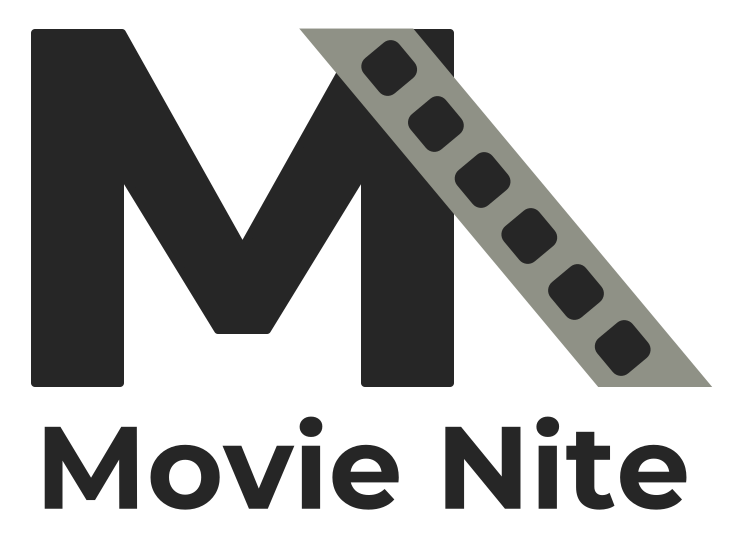

  <picture>
    <source media="(prefers-color-scheme: dark)" srcset="src/assets/logo/logo-dark-transparent.svg">
    
  </picture>

<h1 align="center">Movie Nite</h1>

Pick tonight's film for the FFF movie-night group: viewers nominate films from TMDB, and a weighted, editable wheel picks what to watch.

## Credits

Film data is from TMDB, and the recorded sounds are CC0 or public domain. Both are credited in the app (⚙ menu, Credits), from the list in [src/assets/sound/credits.ts](src/assets/sound/credits.ts); the cut points are in [src/assets/sound/README.md](src/assets/sound/README.md).
